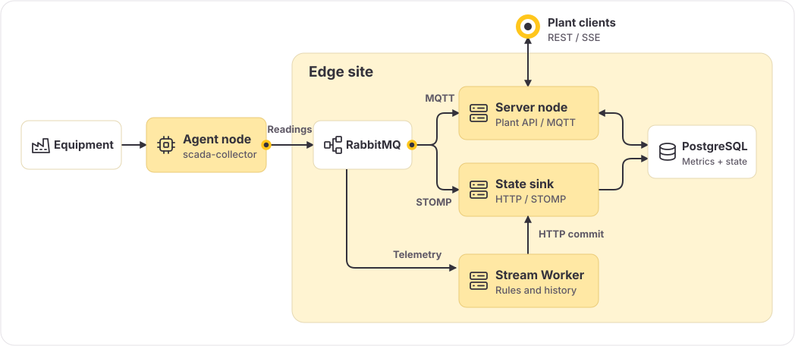

# SCADA

`@yarkivaev/scada` provides the collector runtime, Scala Supervisor engine, state sink and plant API for industrial monitoring.

- [Quick-start guide](docs/quick-start.md) — install the package and run a local API.
- [Documentation](docs/README.md) — installation, architecture, collection, operations and reference.

## Architecture

- **Collect near the equipment.** `scada-collector` runs device and stream adapters and delivers readings to their configured destinations.
- **Process readings with plant rules.** [Supervisor](supervisor-engine/README.md) turns telemetry into timeline segments. The [state sink](docs/architecture/README.md#state-sink) persists segments, decisions and alerts, and the site API serves them to clients.
- **Keep plant state local.** An edge site can store its metrics and state in PostgreSQL. A central site can archive selected metrics from multiple edge sites in ClickHouse.
- **Manage placement separately.** Agents can run from local manifests. An optional `scada-controller` assigns work through etcd, and agents can continue running saved assignments during a control-plane outage.

See the [deployment diagrams](docs/architecture/README.md) for multi-site archives and managed agents.

## Package boundary

SCADA owns the shared collection and processing engines, storage and APIs. Plant packages such as `sokol-scada` supply the deployment DSL, device mappings, business rules, routes and HMI. See the [package boundary](docs/architecture/package-boundary.md).

[MIT license](LICENSE)
