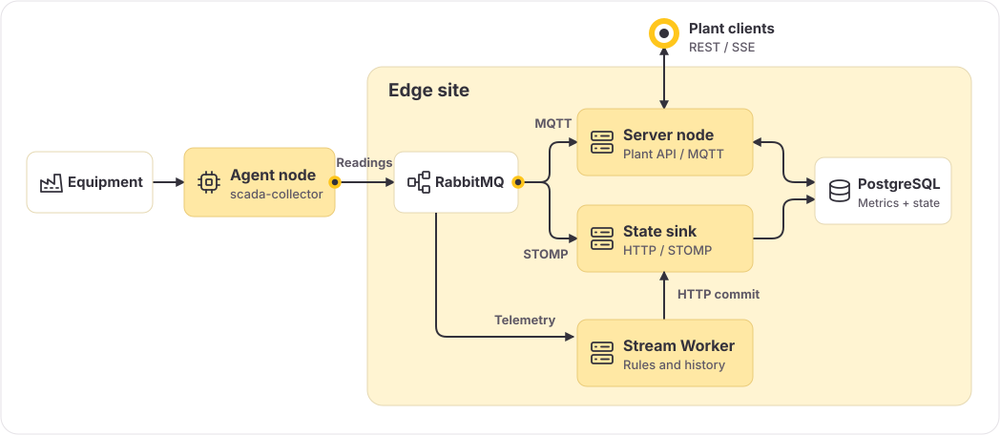
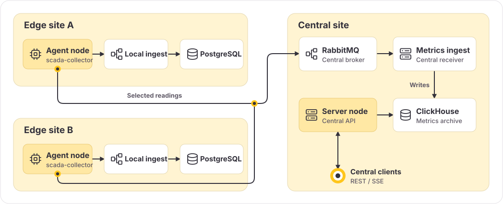
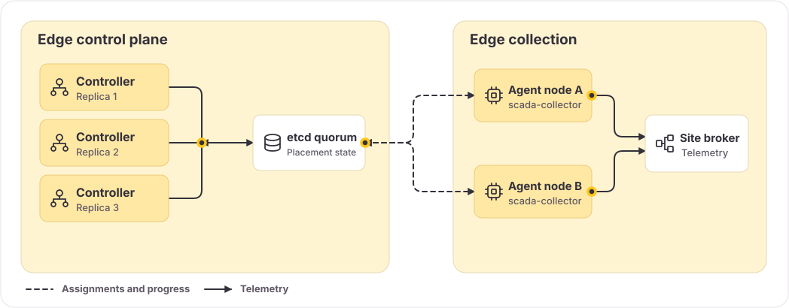
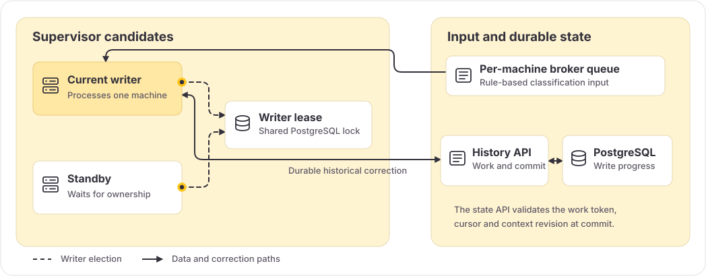

[Documentation](../README.md)

# Architecture

## Servers and agents

- A **server** runs a plant application using `siteServer` and exposes its plant API.
- An **agent** runs device or stream tasks through `scada-collector` and delivers observations to the configured destinations.
- An optional **controller** runs through `scada-controller` and places tasks on eligible agents using etcd.

## Supervisor engine

The [Scala Supervisor engine](../../supervisor-engine/README.md) turns machine readings into timeline segments. It evaluates configured rules, applies operator decisions, restores checkpoints and publishes segments. Plants supply the rules and can plug in a specialized live processor or historical classifier.

SCADA also provides a pure processor contract, a stream worker with durable checkpoints and a separate replay planner. The replay planner can compute sections of the same timeline in parallel when their starting states are known. See [Stream processing modules](../../supervisor-engine/README.md#stream-processing-modules).

## State sink

`supervisor-sink` is the state sink executable and Helm workload. It consumes STOMP messages for timeline segments, user decisions and alerts and persists them in PostgreSQL. It also serves the internal state HTTP API.

The usual Helm deployment runs the plant API in site-server and the three STOMP consumers in supervisor-sink. Collector assignments belong to the optional controller. The Scala Supervisor produces classified segments. Other plant services can publish decisions and alerts through the same broker.

## Single edge site

In this example, the collector publishes readings to RabbitMQ. Supervisor reads the telemetry and publishes segments over STOMP. The site server writes raw metrics, the state sink writes operational state, and plant clients query the local API.

## Edge sites with a central archive

Each edge site keeps its local store and plant API. Agents with a central destination also publish selected readings to the central broker. The central API reads archived metrics from ClickHouse.

Local and central destinations confirm delivery independently. See [Durable delivery](../collect/durable-delivery.md).

## Managed agents with a replicated control plane

Controller replicas reconcile assignments through an etcd quorum. Each agent reads its assignment from etcd, reports progress and saves the last applied assignment locally. The broker carries telemetry independently of this control path.

If etcd loses quorum, new placement pauses and running agents can continue using their saved assignments. Pin tasks that require a physical device to the node where that device is attached. See [Edge assignment controller](../collect/edge-controller.md).

## Replicated Supervisor and historical workers

A deployment can keep Supervisor candidates on different edge nodes. With a shared PostgreSQL lease, a candidate must acquire the per-machine lock to write. Historical correction resumes from durable work and rejects a stale claim or changed context. See [High availability](high-availability.md) for replica placement, handoff and failure guarantees.

## Further reading

- [Data flow](data-flow.md)
- [Package boundary](package-boundary.md)
- [Source layout](source-layout.md)

---

← [Deployment configuration](../deploy.md) · [Data flow](data-flow.md) →
