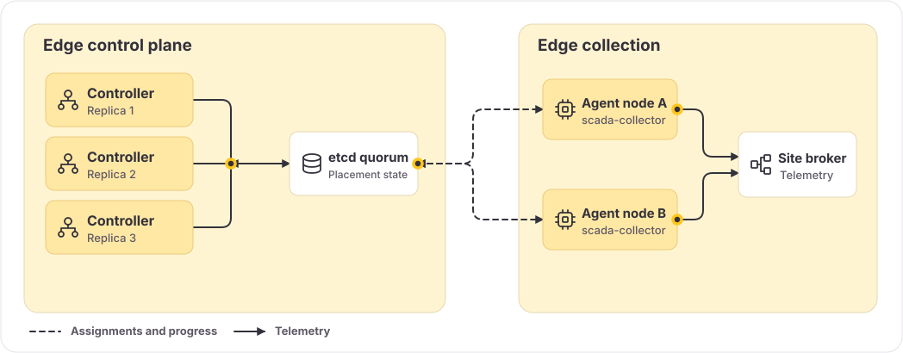
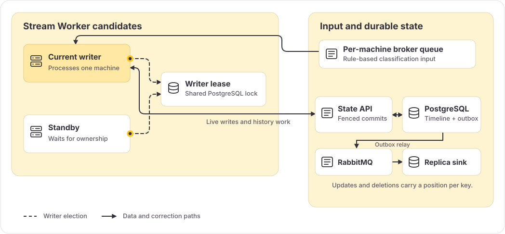

[Documentation](../README.md) / [Architecture](README.md)

# High availability

SCADA can distribute collection and processing across edge nodes. Collection can have several active readers for one source. Processing can have several eligible stream processor instances, with one selected writer per machine when writer coordination is configured.

| Layer | What can be replicated | How ownership is coordinated |
| --- | --- | --- |
| Control plane | Controller replicas and etcd members | A controller acquires an etcd lease. Assignment writes compare the leader identity, lease and expected revisions in an etcd transaction. |
| Collection | A logical task on several eligible nodes | The scheduler places copies using capacity, locality and evidence of recent source reads. Each agent saves its own assignment before applying it. |
| Processing | Stream Worker candidates and the readings and segment state they need | The deployment selects the eligible writer. When candidates share the same PostgreSQL lease database, a per-machine advisory lock grants one session ownership. |
| Historical correction | A worker can resume durable work after a process restart or handoff | The state API validates the work token, cursor and context revision before writing a page. Stateful corrections stage output until completion or verified convergence. |

## Controller and etcd quorum

etcd stores the catalog, assignments and agent reports. The controller reconciles desired assignments from the catalog and current reports. Replicas can compete for leadership. A controller whose leader lease was revoked cannot commit a new assignment with the old lease.

A majority of etcd voters must be reachable to commit new assignments. If the quorum is lost, placement and handoff pause. A running agent continues its in-memory assignment. After restart it waits for the controller. The device-to-broker data path runs independently of etcd. When the quorum returns, the controller can reconcile against current reports. Restoring an older etcd snapshot requires a new `controlEpoch`. See [controller configuration and recovery](../collect/edge-controller.md).

## Replicated collectors

The catalog expresses one logical task with a desired number of copies, allowed nodes and resource cost. Network tasks default to two copies in the generic scheduler when no explicit count is supplied. Physical serial tasks use `pinnedNode` and stay on one host. Each deployment supplies source-specific replication policy and delivery destinations.

The scheduler tries to cover every source before adding extra copies. A running process heartbeat establishes node liveness. A fresh reading for the current task generation, matching specification and control epoch establishes read progress. When changing placement, the controller retains the previous reader until enough replacements show fresh progress, subject to task eligibility and failures. An unreachable node may still be reading from its current in-memory assignment, so more than the desired copies can overlap during recovery.

Active readers and delivery retries can produce duplicate observations. The destination determines whether it deduplicates observations, operations or events. Durable delivery uses a local spool or a configured state store and tracks recipient confirmations. A local spool survives a process restart while its storage survives. See [durable delivery](../collect/durable-delivery.md).

## Replicated stream processing and history workers

Provide the standby with the telemetry and segment state it needs to resume. That can mean shared state or deployment-managed replication to another edge. When PostgreSQL lease mode is enabled, candidates for a machine must use the same authoritative lease database. The advisory lock is held for the database session. A candidate that misses the lock waits. When the session closes, another candidate can acquire the lock and receive a new generation. The shared engine can stamp that generation on history publications. Receiver enforcement depends on the deployment and protocol.

A standby readiness check compares local observation progress with a positive replicated segment end. Catch-up is based on data progress. Merely starting a new stream processor does not establish readiness to publish. The exact selection, broker routing and failback policy belong to the deployment.

The shared engine supports rule-based classification from a per-machine queue. A site profile can use the durable history API for historical correction. A page commit validates the work token and context revision. It records the page result and advances durable progress inside the same transaction. Stateful workers stage computation under the current work generation, then apply the result atomically with current operator metadata. A stale claim or a changed context requires a fresh read. A restarted worker resumes from the committed cursor and checkpoint. See [edge history protocols](../reference/edge-history.md) and [stream processing configuration](../../stream-processing/README.md).

## Timeline replicas

With [timeline replication v2](../reference/edge-history.md#delivering-committed-segments-to-replicas), fenced live writes and historical corrections share one PostgreSQL outbox. The authority commits the final row changes, their outbox records and any history progress together. The relay removes a record after a persistent RabbitMQ publication is confirmed.

Replicas apply insertions, updates and deletions with the latest position for each segment key and authority database. A repeated insertion cannot revive a deleted key. A delayed deletion leaves a later live write at the same key intact. This convergence guarantee applies to fenced writes from one authoritative database per machine. Authority changes, direct edits and local maintenance have separate paths.

## Failure guarantees

| Failure | What the system can preserve | What recovery depends on |
| --- | --- | --- |
| Controller process stops | Running readers keep their current assignments. With etcd quorum, another controller can acquire leadership. | A controller replica and a majority of voters remain available. |
| etcd loses quorum | Agents with persisted assignments can continue. | New placement and control changes wait for quorum. |
| A collector node stops | A healthy copy may keep collecting. With sufficient eligible capacity, the controller can place a replacement. | A live source, a reachable destination or available spool space, and another eligible host. A pinned device stays with its physical host. |
| Broker or link is interrupted | A durable path can retain queued or spooled records and retry each recipient. | Retained queue and spool data, sufficient capacity and a destination that handles replay. |
| Stream processor or history worker stops | Committed segments and history progress remain available from durable state. A prepared writer or worker can resume. | The previous lock releases, the candidate has the required input and state, and the destination remains reachable. |
| Authority or relay stops after a timeline commit | Pending v2 changes remain in the PostgreSQL outbox. A repeated delivery uses the same ID and position. | The authority database survives and the configured replica queues and consumers recover. |
| Storage or raw history is lost | Recovery can use the data and checkpoints that survived. | Deployment-managed replication and backups set the recovery limit. |

These guarantees apply to individual paths. They do not establish a fixed failover time, zero data loss or end-to-end exactly-once delivery for an entire site. Plan broker and datastore replication and backups independently of the controller.

## See also

- [Deploy named processes and broker bindings](../deploy.md)
- [Controller settings and clock requirements](../collect/edge-controller.md#read-evidence-and-clocks)
- [Troubleshooting and checks](../operations/troubleshooting.md)
